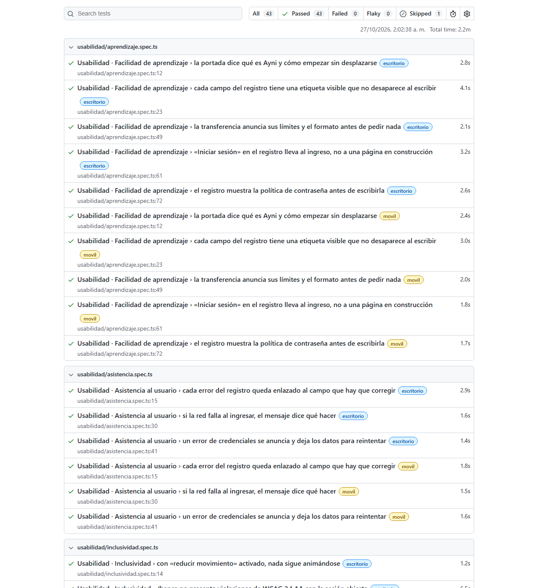

# Reporte de evaluación de usabilidad · ISO/IEC 25010

**Historia:** AYNI-222 (T-22, capítulo 15 del informe del APF3) · **Corte:** 27-oct-2026, Sprint 5 en
curso (de 8) · **Característica:** *capacidad de interacción* (usabilidad) de ISO/IEC 25010:2023,
medida con la forma de ISO/IEC 25023 · **Datos:** la suite automatizada de usabilidad del capítulo 14
(`web/ayni-web/e2e/usabilidad/`, T-21), una revisión de la interfaz contra el código y axe-core sobre
las pantallas de la aplicación.

---

## 1. Qué se mide y con qué escala

Se usa la misma escala que el [reporte de calidad funcional](reporte-calidad-funcional.md):
**X = 1 − A / B**, de 0 (nada) a 1 (todo).

| Subcaracterística | Pregunta | Medida | A | B |
|---|---|---|---|---|
| **Facilidad de aprendizaje** | ¿Se entiende sin manual qué pide cada pantalla? | Campos con etiqueta visible | Campos sin etiqueta | Campos de entrada |
| | | Formatos anunciados de antemano | Campos que exigen un formato y no lo dicen hasta fallar | Campos que exigen un formato |
| **Protección contra errores del usuario** | ¿La interfaz evita los errores evitables y deja corregir los demás? | Acciones sensibles protegidas | Acciones sin la protección que necesitan | Acciones que mueven dinero o cambian la seguridad |
| **Asistencia al usuario** | ¿La pueden usar personas con capacidades distintas y, cuando algo falla, saben qué hacer? | Mensajes de error comprensibles | Mensajes que no dicen qué pasó **y** qué hacer | Mensajes de error que ve el cliente |
| | | Pantallas sin barreras de accesibilidad | Pantallas con violaciones de WCAG 2.1 AA | Pantallas evaluadas con axe-core |
| **Compromiso del usuario** | ¿Resulta agradable y motiva a seguir usándola? | Puntuación SUS de usuarios representativos | — | — |

**Nivel de cumplimiento**, el mismo del capítulo 12: ≥ 0,90 **Alto** · 0,75–0,89 **Aceptable** ·
0,50–0,74 **Parcial** · < 0,50 **Insuficiente**.

**Antes y después.** La evaluación encontró defectos y se corrigieron en el mismo ciclo. Cada medida
se informa con el valor al empezar a medir y con el valor tras la corrección, y la corrección está
enlazada a su commit. Ocultar el «antes» haría parecer que la evaluación no sirvió de nada.

**Operabilidad e inclusividad** también son subcaracterísticas de la capacidad de interacción. Sus
pruebas están en el capítulo 14 (sección 6 de este reporte); aquí se resumen sus resultados.

## 2. Facilidad de aprendizaje

| Medida | B | A antes | X antes | A ahora | X ahora | Nivel |
|---|---:|---:|---:|---:|---:|---|
| Campos con etiqueta visible | 18 | 0 | 1,00 | 0 | **1,00** | Alto |
| Formatos anunciados de antemano | 11 | 1 | 0,91 | 0 | **1,00** | Alto |

**Campos con etiqueta.** Se recorrieron los formularios de registro, ingreso, recuperación de la
contraseña, transferencia, depósito y tarjeta: 18 campos, todos con una etiqueta `<label>` que se ve y
no desaparece al escribir (no se usa el `placeholder` como etiqueta). La prueba *cada campo del
registro tiene una etiqueta visible que no desaparece al escribir* lo vigila en la CI.

**Formatos anunciados.** De los 11 campos que exigen un formato (DNI, celular, tres correos,
contraseña, fecha de nacimiento, cuenta de destino, dos importes y el límite de la tarjeta), diez lo
decían antes de escribir, con una ayuda, un ejemplo o, en la fecha, el propio selector de fecha del
navegador, que ya muestra el formato. **El número de DNI no**: su ayuda hablaba del
cifrado y los ocho dígitos se descubrían al fallar. Corregido en *fix(web): decir el formato del DNI y
revisar la banca con axe*.

Además, la transferencia y el depósito muestran su límite antes de pedir el importe, y el registro
muestra la política de contraseña antes de escribirla. Los dos casos tienen prueba automatizada.

## 3. Protección contra errores del usuario

| Medida | B | A antes | X antes | A ahora | X ahora | Nivel |
|---|---:|---:|---:|---:|---:|---|
| Acciones sensibles protegidas | 10 | 1 | 0,90 | 0 | **1,00** | Alto |

| Acción | Protecciones | Estado |
|---|---|---|
| Transferir | Validación antes de enviar · resumen para revisar · segundo factor · clave de idempotencia por operación · el botón se bloquea mientras procesa · «Corregir» conserva lo escrito | Protegida |
| Depositar | Validación · límite visible · el botón se bloquea mientras procesa · **clave de idempotencia por operación** | Protegida tras la corrección |
| Código del segundo factor | Solo números · no envía hasta tener seis · dice cuántos intentos quedan · pausa tras varios fallos | Protegida |
| Congelar y descongelar la tarjeta | Reversible al instante; el resultado se anuncia | Protegida |
| Límite diario de la tarjeta | Validación (mayor que cero, dos decimales); se puede volver a cambiar | Protegida |
| Compras por internet | Interruptor reversible; dice qué pasa si se desactivan | Protegida |
| Registro | Validación por campo · mayoría de edad · consentimiento que nunca viene marcado · política de contraseña visible | Protegida |
| Ingreso | Pausa progresiva tras intentos fallidos · mostrar la contraseña · no revela si el correo existe | Protegida |
| Contraseña nueva | Política visible requisito a requisito · confirmación | Protegida |
| Datos leídos del DNI | Se revisan y se corrigen antes de continuar | Protegida |

**El defecto: el depósito podía duplicarse.** La página promete *«Sin cobros dobles: si la conexión
falla y vuelves a confirmar, la operación no se repite»*, pero generaba una clave de idempotencia
nueva en cada envío. Si la red fallaba después de que el servidor registrara el depósito, el
reintento llevaba otra clave y se registraba otro depósito. La transferencia sí lo hacía bien. Ahora
el depósito conserva la clave mientras el importe sea el mismo, y tiene tres pruebas que antes no
existían. Corregido en *fix(web): reintentar un depósito con la misma clave de idempotencia*.

En el capítulo 14 se corrigió otro caso de esta subcaracterística: «Corregir» devolvía vacío el
formulario de transferencia (PR #81).

## 4. Asistencia al usuario

| Medida | B | A antes | X antes | A ahora | X ahora | Nivel |
|---|---:|---:|---:|---:|---:|---|
| Mensajes de error comprensibles | 50 | 3 | 0,94 | 0 | **1,00** | Alto |
| Pantallas sin violaciones de WCAG 2.1 AA | 12 | 0 | 1,00 | 0 | **1,00** | Alto |

**Mensajes de error.** Se revisaron los 50 mensajes de error que ve el cliente. Un mensaje cuenta como
comprensible si dice **qué pasó y qué hacer**: «El número de cuenta Ayni tiene 14 dígitos» o «La
confirmación venció. Vuelve a confirmar la transferencia» cumplen. Tres no cumplían:

| Mensaje | Qué le faltaba | Ahora |
|---|---|---|
| «La contraseña nueva no cumple la política de seguridad.» | Qué corregir | Remite a la lista de requisitos de la misma pantalla |
| «No pudimos completar la operación» (respuesta del servidor sin cuerpo) | Qué hacer | «… Inténtalo de nuevo en unos minutos.» |
| «No se pudieron cargar los movimientos.» | Qué hacer | «No pudimos cargar tus movimientos. Inténtalo de nuevo en unos minutos.» |

Corregido en *fix(web): que los mensajes de error digan también qué hacer*. Cada error de un campo
está, además, enlazado al campo con `aria-describedby`, para que un lector de pantalla lo lea al
enfocarlo. La prueba *cada error del registro queda enlazado al campo que hay que corregir* lo vigila.

**Accesibilidad.** axe-core evaluó 12 pantallas con las reglas de WCAG 2.1 A y AA, en escritorio y en
celular. Ninguna tiene violaciones:

| Pantallas | Prueba |
|---|---|
| Portada, registro, ingreso, pendientes, foto del DNI (anverso y reverso) | `accesibilidad.a11y.spec.ts` |
| Panel, transferir, depositar y configuración, **con la sesión abierta** | `usabilidad/inclusividad.spec.ts` (nueva en este capítulo) |
| Controles de la tarjeta, activa y congelada | `tarjeta.spec.ts` |
| Recuperación de la contraseña | Medición del corte (sin prueba permanente) |

Hasta este reporte la banca con la sesión abierta, que es donde el cliente pasa su tiempo, no se
revisaba con axe. Ahora queda en la CI.

## 5. Compromiso del usuario

**Sin medir todavía.** El compromiso, es decir si la interfaz resulta agradable y motiva a seguir
usándola, solo lo pueden juzgar personas. No se puede automatizar ni lo puede decidir el propio
equipo. Se medirá con el cuestionario SUS (*System Usability Scale*) del anexo A, con al menos cinco
participantes de 18 a 35 años que no hayan visto la aplicación, antes de la sustentación del APF3.

| Puntuación SUS | Lectura |
|---|---|
| ≥ 80,3 | Excelente |
| 68 – 80,2 | Buena (68 es la media de la industria) |
| 51 – 67,9 | Aceptable con mejoras |
| < 51 | Insuficiente |

Lo que sí se puede afirmar sin usuarios es que la interfaz sigue el diseño aprobado, con un único
sistema de diseño (`docs/marca/design-tokens.md`). Eso es consistencia, no compromiso, y no sustituye
la medición.

## 6. Relación con el capítulo 14: la suite automatizada

La suite de usabilidad tiene **22 pruebas** que corren en escritorio y en celular en cada pull request
(`npm run test:usabilidad`).

| Subcaracterística | Pruebas | Resultado del corte |
|---|---:|---|
| Facilidad de aprendizaje | 5 | Todas pasan |
| Operabilidad | 5 | Todas pasan (la de tamaño táctil solo se mide en el celular) |
| Protección contra errores | 4 | Todas pasan |
| Asistencia al usuario | 3 | Todas pasan |
| Inclusividad | 5 | Todas pasan |
| **Total** | **22** | **43 ejecuciones aprobadas y 1 omitida a propósito** |

## 7. Resumen

| Subcaracterística | Medida principal | X antes | X ahora | Nivel |
|---|---|---:|---:|---|
| Facilidad de aprendizaje | Formatos anunciados de antemano | 0,91 | 1,00 | **Alto** |
| Protección contra errores | Acciones sensibles protegidas | 0,90 | 1,00 | **Alto** |
| Asistencia al usuario | Mensajes de error comprensibles | 0,94 | 1,00 | **Alto** |
| Asistencia al usuario | Pantallas sin violaciones de WCAG 2.1 AA | 1,00 | 1,00 | **Alto** |
| Compromiso del usuario | SUS | — | — | **Sin medir** (anexo A) |

**Nivel de cumplimiento de la usabilidad del incremento entregado: Alto en facilidad de aprendizaje,
protección contra errores y asistencia al usuario.** El compromiso del usuario queda pendiente de la
prueba con participantes.

Que todo termine en 1,00 no significa que la interfaz no tenga nada que mejorar. Significa que lo
encontrado con estas medidas se corrigió. Entre el capítulo 14 y este, la evaluación encontró y
corrigió **diez defectos de usabilidad**:

| Defecto | Subcaracterística | Corregido en |
|---|---|---|
| «Corregir» devolvía vacío el formulario de transferencia | Protección contra errores | PR #81 |
| «Iniciar sesión» y «Entrar a mi banca» llevaban a «todavía no está lista» | Facilidad de aprendizaje | PR #81 |
| El foco del registro volvía hacia arriba en el celular (WCAG 2.4.3) | Operabilidad | PR #81 |
| El foco no se distinguía en el botón de la contraseña (WCAG 2.4.7) | Operabilidad | PR #81 |
| Las animaciones ignoraban «reducir movimiento» (WCAG 2.3.3) | Inclusividad | PR #81 |
| El depósito podía duplicarse al reintentar | Protección contra errores | Este PR |
| Tres mensajes de error no decían qué hacer | Asistencia al usuario | Este PR |
| El DNI no decía su formato antes de pedirlo | Facilidad de aprendizaje | Este PR |

### Acciones derivadas

| Acción | Dónde |
|---|---|
| Aplicar el cuestionario SUS del anexo A a cinco participantes y completar la sección 5 | T-22, antes del APF3 |
| Añadir la recuperación de la contraseña a las pruebas permanentes de axe | Nueva tarea de HU-17 |
| Repetir esta evaluación al cierre del Sprint 8, con la tarjeta y la transferencia interbancaria ya entregadas | T-22 del PROY |

---

## Anexo A · Cuestionario SUS

Cada participante hace tres tareas en la aplicación desplegada y después responde el cuestionario.
La persona que conduce la prueba no ayuda; anota dónde se detiene el participante y cuánto tarda.

**Tareas**

1. Abrir una cuenta hasta la pantalla del DNI (sin enviar documentos reales).
2. Ingresar con la cuenta de prueba y ver el saldo y los últimos movimientos.
3. Transferir S/ 10 a la cuenta de prueba indicada y descargar el comprobante.

**Cuestionario** (1 = totalmente en desacuerdo · 5 = totalmente de acuerdo)

| N.º | Afirmación |
|---|---|
| 1 | Creo que me gustaría usar esta aplicación con frecuencia. |
| 2 | Encontré la aplicación innecesariamente compleja. |
| 3 | Pensé que la aplicación era fácil de usar. |
| 4 | Creo que necesitaría ayuda de una persona con conocimientos técnicos para usarla. |
| 5 | Las funciones de la aplicación estaban bien integradas. |
| 6 | Pensé que había demasiada inconsistencia en la aplicación. |
| 7 | Imagino que la mayoría de la gente aprendería a usarla muy rápido. |
| 8 | Encontré la aplicación muy engorrosa de usar. |
| 9 | Me sentí muy seguro al usar la aplicación. |
| 10 | Necesité aprender muchas cosas antes de poder usarla. |

**Cálculo.** En las afirmaciones impares se resta 1 a la respuesta; en las pares, la respuesta se
resta de 5. La suma de los diez valores se multiplica por 2,5 y da una puntuación de 0 a 100. Se
informa la media de los participantes.

| Participante | Edad | Tarea 1 | Tarea 2 | Tarea 3 | SUS |
|---|---:|---|---|---|---:|
| P1 | | | | | |
| P2 | | | | | |
| P3 | | | | | |
| P4 | | | | | |
| P5 | | | | | |
| **Media** | | | | | |
