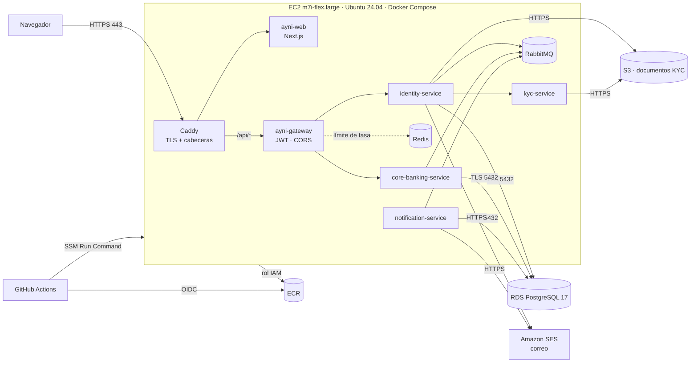

# Manual de despliegue · Ayni Bank en AWS

> Cómo se monta producción desde cero y cómo llega cada versión. La decisión y sus alternativas
> están en [ADR-0026](../arquitectura/adr/0026-produccion-en-aws-con-despliegue-continuo.md).
>
> **Versión 2 del manual** (release 2.0.0, 30-oct-2026). Lo nuevo respecto a la 1.x está en la
> [sección 12](#12-versión-2-qué-cambió-al-desplegar-la-200) y la verificación contra la nube, en la
> [sección 13](#13-validación-de-la-versión-desplegada).

## 1. Arquitectura desplegada



| Recurso | Nombre | Notas |
|---|---|---|
| Región | `us-east-1` | |
| Instancia | `ayni-bank-prod` | IP elástica, sin SSH. No se enciende sola; se apaga cada día a las 23:00 (Lima) |
| Base de datos | `ayni-bank-prod` | `db.t4g.micro`, 20 GB gp3 cifrados, copia diaria y PITR de 1 día (límite del plan gratuito) |
| Bucket | `ayni-kyc-documentos-<cuenta>` | Privado, cifrado, versionado, solo TLS |
| Registro | `ayni/*` en ECR | 6 repositorios, escaneo al publicar, 10 imágenes por servicio |
| URL | `https://ayni.<ip-con-guiones>.sslip.io` | Certificado de Let's Encrypt emitido por Caddy |

## 2. Requisitos previos

- AWS CLI v2 autenticado con una identidad con permisos de administración (solo para el paso 3).
- `gh` autenticado contra el repositorio.
- Ninguna herramienta en la instancia: la prepara su `UserData` (Docker, Compose, AWS CLI, psql).

## 3. Crear la infraestructura (una sola vez)

```bash
aws cloudformation deploy \
  --stack-name ayni-bank-prod \
  --template-file infra/aws/ayni-bank.cfn.yaml \
  --capabilities CAPABILITY_NAMED_IAM \
  --region us-east-1

aws cloudformation describe-stacks --stack-name ayni-bank-prod \
  --query "Stacks[0].Outputs" --output table
```

Tarda unos 15 minutos, casi todos de RDS. La salida da la URL, el id de la instancia, el *endpoint*
de la base de datos y el ARN del rol de despliegue.

## 4. Cargar los secretos (una sola vez)

Se guardan en Parameter Store como `SecureString`. Ninguno se escribe en el repositorio.

```bash
P=/ayni/prod
aws ssm put-parameter --type SecureString --name $P/jwt-clave            --value "$(openssl rand -base64 48)"
aws ssm put-parameter --type SecureString --name $P/cifrado-clave        --value "$(openssl rand -base64 32)"
aws ssm put-parameter --type SecureString --name $P/confirmacion-clave   --value "$(openssl rand -base64 32)"   # desde la 2.0
aws ssm put-parameter --type SecureString --name $P/operador-clave       --value "$(openssl rand -base64 24 | tr -d '/+=')"   # opcional
aws ssm put-parameter --type SecureString --name $P/db-app-contrasena    --value "$(openssl rand -base64 24 | tr -d '/+=')"
aws ssm put-parameter --type SecureString --name $P/rabbitmq-contrasena  --value "$(openssl rand -base64 24 | tr -d '/+=')"
aws ssm put-parameter --type SecureString --name $P/grafana-contrasena   --value "$(openssl rand -base64 18 | tr -d '/+=')"
aws ssm put-parameter --type String       --name $P/db-host              --value "<EndpointBaseDeDatos>"
aws ssm put-parameter --type String       --name $P/db-secreto-admin     --value "<SecretoBaseDeDatos>"
aws ssm put-parameter --type String       --name $P/bucket-kyc           --value "<BucketKyc>"
aws ssm put-parameter --type String       --name $P/correo-tls           --value "<correo del equipo>"
```

Las credenciales maestras de RDS las genera y custodia RDS en Secrets Manager; las del bucket, la
propia plantilla (`ayni/prod/almacen`). El script de despliegue crea en la primera ejecución el
usuario de aplicación `ayni_app`, que es el único que usan los servicios.

## 5. Conectar GitHub (una sola vez)

```bash
gh variable set AWS_ROL_DESPLIEGUE --body "<RolDespliegueArn>"
gh variable set AWS_INSTANCIA      --body "<InstanciaId>"
gh variable set AYNI_URL           --body "<Url>"
```

Son **variables**, no secretos: ninguna da acceso por sí sola. El acceso lo da el rol, y solo a este
repositorio desde `main`.

## 6. Desplegar una versión

No se despliega a mano. El flujo es el de siempre:

1. Rama `feature/AYNI-NN-…` desde `develop` → Pull Request → CI verde → *merge* a `develop`.
2. Pull Request de `develop` a `main` → CI verde → *merge*.
3. El *push* a `main` dispara **CD**: CI completa otra vez, imágenes a ECR, despliegue por SSM,
   pruebas de humo y, si la versión de `VERSION` es nueva, tag `vX.Y.Z` y Release.

Para comprobar a simple vista que llegó: la pantalla de ingreso muestra **«versión vX.Y.Z»**.

## 7. Volver a una versión anterior

- **Automático:** si las pruebas de humo fallan, el job *Revertir* restaura la configuración y las
  imágenes anteriores.
- **Manual:** *Actions → CD → Run workflow*, con la etiqueta (sha corto) de la versión a la que se
  quiere volver. Las 10 últimas imágenes de cada servicio siguen en ECR.

## 8. Operación diaria

| Qué | Cómo |
|---|---|
| Entrar a la instancia | `aws ssm start-session --target <InstanciaId>` |
| Ver los contenedores | `cd /opt/ayni && docker compose -f docker-compose.prod.yml ps` |
| Ver los registros | `docker logs ayni-core-banking-service --since 10m` |
| Salud | `curl https://<url>/api/health` |
| Tableros (Grafana) | `https://<url>/grafana` · usuario `admin`, contraseña en `/ayni/prod/grafana-contrasena` |
| Métricas de la base | Consola RDS → `ayni-bank-prod` → *Monitoring* y *Logs & events* (CloudWatch) |
| Restaurar la base a un instante | Consola RDS → *Restore to point in time* (crea una instancia nueva) |
| Encender fuera de horario | `aws ec2 start-instances --instance-ids <InstanciaId>` |

## 9. Pruebas de humo que corre el pipeline

`infra/scripts/pruebas-humo.sh` comprueba, contra la URL pública:

1. `GET /api/health` responde `UP`.
2. La web responde 200.
3. La pantalla de ingreso muestra la versión recién desplegada.
4. HTTP redirige a HTTPS.
5. Están las cabeceras HSTS, `X-Frame-Options: DENY` y `Content-Security-Policy`, y no se expone `X-Powered-By`.
6. Un inicio de sesión con datos inválidos devuelve **400**, no 200 ni 500.
7. Una ruta protegida sin token devuelve **401**.

## 10. Observabilidad

Prometheus, Grafana y node-exporter corren en la misma instancia (AYNI-159). Solo Grafana se
publica, en `/grafana` y con contraseña; Prometheus y los endpoints `/actuator/prometheus` viven en
la red interna de Docker. La configuración se versiona en `infra/observability/` y la descarga
`desplegar.sh` del mismo commit que se despliega.

| Tablero | Qué responde |
|---|---|
| **Ayni Bank · Salud técnica** | ¿Está arriba? Servicios activos, disponibilidad 24 h (SLO 99,5 %), peticiones/s, errores 5xx (SLO < 1 %), latencia p95 (SLO < 500 ms), heap y CPU de cada JVM, conexiones a RDS, CPU/memoria/disco/red de la EC2 y latencia del OCR. |
| **Ayni Bank · KPIs de negocio** | ¿Se usa? Transferencias y depósitos, importe movido, ticket promedio, tasa de éxito, rechazos por motivo, ingresos exitosos y fallidos, bloqueos y reutilización de tokens. |

Las métricas de negocio las emiten los servicios con Micrometer (`ayni_operaciones_total`,
`ayni_operaciones_importe_soles_total`, `ayni_operaciones_rechazos_total`,
`ayni_acceso_eventos_total`) y no llevan etiquetas que identifiquen al cliente.

## 11. Alta disponibilidad de la base de datos

El nivel 1 del [ADR-0037](../arquitectura/adr/0037-alta-disponibilidad-de-la-base-de-datos.md)
(RPO 0 y RTO menor de 5 minutos ante la caída de un nodo) está en la plantilla, **apagado**. Activarlo
duplica el coste de la instancia y del almacenamiento de RDS y saca la base del plan gratuito, así que
lo decide el equipo con el presupuesto delante (calculadora de AWS).

**Activarlo** (RDS crea la réplica en otra zona sin parar la base; tarda de 15 a 30 minutos):

```bash
aws cloudformation deploy \
  --stack-name ayni-bank-prod \
  --template-file infra/aws/ayni-bank.cfn.yaml \
  --capabilities CAPABILITY_NAMED_IAM \
  --parameter-overrides AltaDisponibilidad=true \
  --region us-east-1
```

**Comprobar la conmutación** en una ventana sin clientes. RDS promueve la réplica y mueve el DNS del
*endpoint*, y los servicios reconectan solos:

```bash
aws rds reboot-db-instance --db-instance-identifier ayni-bank-prod --force-failover
aws rds describe-events --source-identifier ayni-bank-prod --source-type db-instance --duration 30
```

El tiempo entre los eventos *Multi-AZ instance failover started* y *completed* es el RTO real. Hay
que anotarlo como evidencia.

**Nivel 2 (desastre regional, RPO menor de 5 minutos).** Se replican las copias automáticas y el WAL
a otra región. Desde ahí se restaura a un instante si cae `us-east-1`:

```bash
aws rds start-db-instance-automated-backups-replication \
  --source-db-instance-arn <arn-de-ayni-bank-prod> \
  --backup-retention-period 7 --region us-west-2 \
  --kms-key-id <arn-de-una-clave-kms-en-us-west-2>   # la base esta cifrada: hace falta una clave en destino
```

**Laboratorio local.** Para ver y medir el nivel 1 sin AWS, sin tocar la base de desarrollo:

```bash
docker compose -f infra/docker/ha/docker-compose.yml up -d --wait
infra/scripts/prueba-de-conmutacion.sh        # RPO, coste por confirmación y RTO
docker compose -f infra/docker/ha/docker-compose.yml down -v
```

## 12. Versión 2: qué cambió al desplegar la 2.0.0

La 2.0 reúne los sprints 3 a 5: transferencias con segundo factor, interbancaria, notificaciones por
correo, tarjeta de débito virtual y recuperación de contraseña. La infraestructura de la plantilla
es la misma; cambian los secretos, dos contenedores y una configuración de un solo uso.

| Pieza | Qué cambia | Dónde |
|---|---|---|
| Confirmación de operaciones | Las transferencias piden un código de segundo factor firmado con una clave propia, distinta de la del JWT | SSM `/ayni/prod/confirmacion-clave` (nuevo, obligatorio) |
| Panel del operador KYC | Clave del operador que aprueba aperturas pendientes | SSM `/ayni/prod/operador-clave` (opcional) |
| Límite de tasa | El gateway cuenta las peticiones en **Redis** (48 MB, sin disco), compartido por todas sus réplicas | contenedor `ayni-redis` |
| Correo | identity (códigos y recuperación) y notification (un correo por movimiento) envían por **Amazon SES**; el rol de la instancia solo puede enviar desde el remitente verificado | plantilla, `ses:FromAddress` |
| Interbancaria | core-banking habla con la cámara de compensación por su contrato OpenAPI; en producción la cámara es el simulador del propio servicio (`/simulador/camara/v1`) | `AYNI_CAMARA_URL` |
| Tarjeta de débito | El PAN se guarda cifrado con AES-256-GCM y una huella para la unicidad; la web solo ve los últimos 4 dígitos | `AYNI_CIFRADO_CLAVE` (la misma de siempre) |
| Cuentas | Toda consulta de cuentas exige sesión en el gateway, también la del final del registro (ADR-0038) | `application.yml` del gateway |
| Base de datos | Migraciones Flyway nuevas en identity y core-banking; se aplican solas al arrancar cada servicio | `db/migration` de cada servicio |

### Procedimiento que se siguió (y que se repite en la próxima versión mayor)

1. **Copia de la base antes de tocar nada.** Las migraciones no tienen vuelta atrás automática:
   ```bash
   aws rds create-db-snapshot --db-instance-identifier ayni-bank-prod      --db-snapshot-identifier ayni-bank-prod-antes-de-2-0-0
   aws rds wait db-snapshot-available --db-snapshot-identifier ayni-bank-prod-antes-de-2-0-0
   ```
2. **Secretos nuevos** (sección 4): `confirmacion-clave`. Sin él, `desplegar.sh` (con `set -e`) se
   detiene al leerlo, antes de cambiar ningún contenedor.
3. **Release:** rama `release/2.0.0` desde `develop`, `VERSION` a `2.0.0`, PR a `main` con la CI
   completa en verde y la aprobación de la revisora. El *push* a `main` dispara el CD, que enciende la
   instancia si está apagada, publica las imágenes en ECR, despliega por SSM, pasa las pruebas de humo
   y crea el tag `v2.0.0` con su Release.
4. **Republicar los titulares una sola vez.** notification-service nació en la 2.0 y no conoce a los
   clientes que ya existían. Por SSM Run Command se recrea identity con
   `AYNI_REPUBLICAR_TITULARES=true` (variable del compose de producción), que vuelve a anunciar los
   titulares activos, y se recrea otra vez sin ella, que por omisión es `false`.
5. **Alinear ramas:** PR de `main` a `develop` para que `develop` lleve la versión y los *hotfix*.

### Si algo falla

- **Prueba de humo en rojo:** el job *Revertir* restaura las imágenes y la configuración anteriores
  (sección 7). La base no se toca.
- **Migración incompatible:** se restaura el snapshot en una instancia nueva, se apunta
  `/ayni/prod/db-host` a ella y se vuelve a desplegar la etiqueta anterior desde *Run workflow*.
- **Fallo intermitente en la CI del CD** (nos pasó con la 2.0): el CD se corta antes de desplegar, así
  que producción sigue en la versión anterior. Se corrige con un `hotfix/` a `main` y el CD vuelve a
  correr solo.

## 13. Validación de la versión desplegada

Además de las pruebas de humo del pipeline, la web tiene una suite de Playwright que corre contra la
URL pública y graba la ejecución en video (`web/ayni-web/e2e/nube`). No levanta nada en local.

```bash
cd web/ayni-web
# Parte pública: portada y cabeceras, registro, ingreso, recuperación, accesibilidad y 401
BASE_URL_NUBE=https://<url> npx playwright test

# Recorrido con sesión: ingreso con TOTP, depósito, transferencia, interbancaria y tarjeta.
# Necesita una cuenta de prueba ya abierta; las variables nunca van al repositorio.
BASE_URL_NUBE=https://<url> NUBE_CORREO=… NUBE_CONTRASENA=… NUBE_TOTP_SEMILLA=…   NUBE_CUENTA_DESTINO=… npx playwright test
```

Con `ROTULOS=1`, cada paso muestra en pantalla qué se está comprobando y la grabación va a cámara
lenta; así se generan los videos de evidencia. El informe queda en `informe-playwright/` y los videos
y trazas en `test-results/`.

| Comprobación (2.0.0, 30-oct-2026) | Resultado |
|---|---|
| CD de `main` (imágenes, despliegue, humo, tag) | verde, tag `v2.0.0` |
| Web por HTTPS y versión en el ingreso | 200, «versión v2.0.0» |
| HSTS, CSP con `frame-ancestors 'none'`, `X-Frame-Options: DENY`, `nosniff` | presentes |
| Registro, ingreso y recuperación sin violaciones WCAG 2.1 AA (axe) | 0 violaciones |
| `GET /api/v1/cuentas/mia` sin token | 401 |
