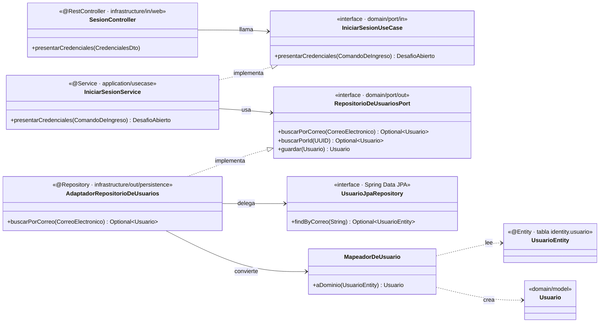
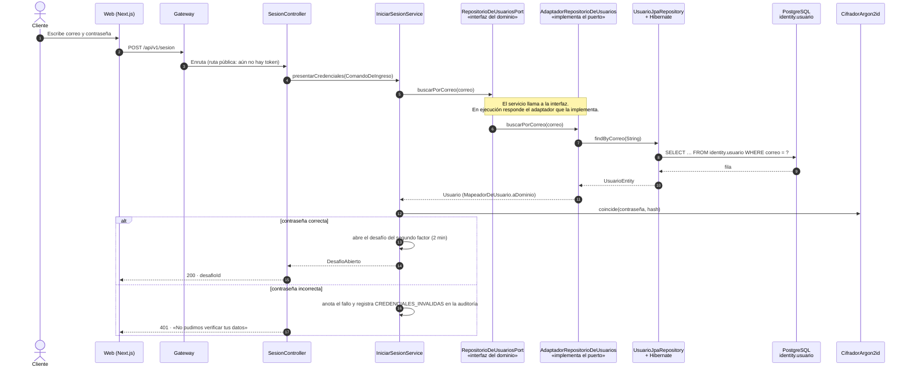
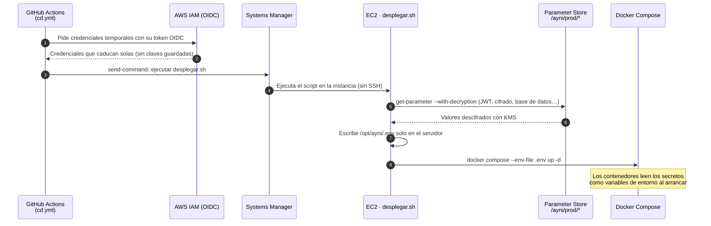

# Levantamiento de las observaciones del APF2

**T-25 · AYNI-225** · Fuente: sustentación del APF2 (semana 9), en la que Ayni Bank expuso como grupo 1.

El APF3 empieza por aquí, igual que el APF2 empezó por las observaciones del APF1: un avance que no corrige lo que se le señaló repite los mismos errores con más código. Cada fila dice qué observó el docente, qué se hizo y dónde comprobarlo.

## Resumen

| N.º | Observación del docente | Cómo se levantó | Evidencia | Estado |
|---|---|---|---|---|
| 1 | El diagrama del patrón de acceso a datos no dejaba ver **quién implementa la interfaz** ni por qué las flechas van al dominio; «infraestructura» se leía como despliegue. | Diagrama de clases rehecho con las tres piezas separadas: puerto, adaptador y repositorio de Spring Data. | [Sección 1](#1-patrón-de-acceso-a-datos-quién-implementa-qué) | Levantada |
| 2 | En el diagrama de secuencia del ingreso no aparecía **dónde está la interfaz**. | Secuencia rehecha con el puerto y el adaptador como piezas distintas. | [Sección 2](#2-secuencia-del-ingreso-con-el-puerto-a-la-vista) | Levantada |
| 3 | «Argon2id **resistente a GPU**» no era la expresión adecuada: lo que importa es la resistencia a la **fuerza bruta**. | Corregido en `SECURITY.md`, explicando por qué resiste. | [Sección 3](#3-argon2id-resistente-a-ataques-de-fuerza-bruta) | Levantada |
| 4 | **¿En qué momento se inyectan los secretos?** | Explicado con el flujo real; GitHub no guarda ninguna clave de AWS. | [Sección 4](#4-cuándo-se-inyectan-los-secretos) | Levantada |
| 5 | **¿Quién aprueba los pull requests?** ¿Puede aprobarlos quien los creó? | Regla del repositorio y registro de aprobaciones reales. | [Sección 5](#5-quién-aprueba-los-pull-requests) | Levantada |
| 6 | Mucho texto: resumir en **tablas e imágenes**. | Este documento y el informe del APF3 presentan cada punto en tablas y diagramas. | Este documento | Levantada |
| 7 | **Siempre expone el Scrum Master**: en la siguiente sustentación deben exponer los demás integrantes. | Reparto de la exposición del APF3 entre todos los integrantes. | Presentación del APF3 (T-28 · AYNI-228) | Se cierra en el APF3 |

## 1. Patrón de acceso a datos: quién implementa qué

El dominio declara lo que necesita de la persistencia como una **interfaz** (el puerto). Una **clase** de infraestructura la implementa (el adaptador), y esa clase delega en un **repositorio de Spring Data**, que es otra interfaz cuyas consultas genera Spring a partir del nombre de cada método.

El ejemplo es el ingreso (HU-04) en `ayni-identity-service`:

| Pieza | Qué es | Dónde está | Lleva anotaciones de framework |
|---|---|---|---|
| `RepositorioDeUsuariosPort` | **El contrato**: lo que el caso de uso necesita | `domain/port/out` | **No.** El dominio no conoce Spring ni JPA |
| `AdaptadorRepositorioDeUsuarios` | **La clase que implementa el contrato** | `infrastructure/out/persistence` | **Sí:** `@Repository` |
| `UsuarioJpaRepository` | Repositorio de Spring Data: `findByCorreo` se convierte en `SELECT … WHERE correo = ?` | `infrastructure/out/persistence`, visible solo en ese paquete | Hereda de `JpaRepository` |
| `MapeadorDeUsuario` | Traduce la fila (`UsuarioEntity`) al objeto del dominio (`Usuario`) | `infrastructure/out/persistence` | No |

**Por qué las dos flechas apuntan al dominio.** El caso de uso *usa* el puerto y el adaptador lo *implementa*, así que los dos dependen del dominio y el dominio no depende de nadie. Es la inversión de dependencias de la arquitectura hexagonal ([ADR-0002](../arquitectura/adr/0002-arquitectura-hexagonal-verificada.md)). Gracias a ella se puede cambiar la base de datos sin tocar ninguna regla de negocio. ArchUnit lo comprueba en cada build: si el dominio importara JPA, la CI fallaría.

**Qué significa «infraestructura» aquí.** En arquitectura hexagonal, *infraestructura* no es dónde se despliega el sistema (eso es AWS, en `infra/`). Es la capa de **adaptadores**: el código que habla con una tecnología concreta, como la base de datos, RabbitMQ, el correo o la web.

## 2. Secuencia del ingreso, con el puerto a la vista

Paso 1 del ingreso: el correo y la contraseña. El caso de uso solo conoce la interfaz `RepositorioDeUsuariosPort`; Spring le inyecta al arrancar la clase que la implementa.

El paso 2 (`POST /api/v1/sesion/segundo-factor`) sigue el mismo camino de puertos y adaptadores. Verifica el código TOTP, abre la familia de tokens de renovación, emite el JWT de acceso de 15 minutos y registra `INGRESO_EXITOSO`.

La consulta es **parametrizada**: el correo viaja como parámetro (`?`) y nunca se concatena al SQL. Por eso este camino no admite inyección SQL.

## 3. Argon2id: resistente a ataques de fuerza bruta

| Antes | Ahora (`SECURITY.md`) |
|---|---|
| Argon2id — resistente a GPU y ASIC | Argon2id — **resistente a ataques de fuerza bruta**: cada intento exige 19 MiB de memoria, y eso encarece probar contraseñas en masa incluso con GPU o ASIC |

Los parámetros están en `CifradorArgon2id`: **19 MiB de memoria, 2 iteraciones y paralelismo 1**, los que recomienda OWASP. La memoria es lo que frena el ataque: una GPU tiene miles de núcleos, pero no puede darle 19 MiB a cada uno a la vez.

## 4. Cuándo se inyectan los secretos

**En el momento del despliegue, dentro del servidor, y nunca desde GitHub.** GitHub Actions no guarda ninguna clave de AWS ni ningún secreto de la aplicación.

| Dónde vive | Qué guarda | Archivo |
|---|---|---|
| Variables de GitHub (no secretas) | El rol a asumir, la instancia y la URL | `.github/workflows/cd.yml` |
| Parameter Store, cifrado con KMS | Claves JWT y de cifrado, contraseñas de la base, RabbitMQ y Grafana | `infra/scripts/desplegar.sh` los lee; `infra/aws/ayni-bank.cfn.yaml` da el permiso |
| Secrets Manager | La contraseña maestra de RDS, que no conoce nadie del equipo | `infra/aws/ayni-bank.cfn.yaml` |
| `/opt/ayni/.env` en la EC2 | Se genera en cada despliegue y nunca sale del servidor | `infra/scripts/desplegar.sh` |
| Repositorio | **Nada.** gitleaks bloquea cualquier PR que intente subir un secreto | `.github/workflows/ci.yml` |

## 5. Quién aprueba los pull requests

Nadie puede aprobar su propio pull request: GitHub no lo permite. Además, el repositorio tiene una regla sobre `main` y `develop` que exige **una aprobación** y el check **«CI completa» en verde** antes de fusionar.

| Regla del repositorio (`main` y `develop`) | Valor |
|---|---|
| Aprobaciones requeridas | 1 |
| Conversaciones resueltas antes de fusionar | Sí |
| Check obligatorio | «CI completa», con la rama al día |
| Borrar la rama o forzar el historial | Bloqueado |

Registro real de los últimos pull requests:

| PR | Autor | Aprobó | Fusionó |
|---|---|---|---|
| #73 a #77 (T-30, T-32, T-33, T-34, AYNI-327, AYNI-252) | Kiara Santti | Joaquín Loa (SM) | Joaquín Loa |
| #66 a #72 y #78 (HU-07, HU-13, intereses, ISO 25010) | Joaquín Loa | Kiara Santti | Joaquín Loa |

Cada PR enlaza su tarea de Jira con `Refs: AYNI-NN`, así que de cada cambio se sabe quién lo escribió, quién lo revisó y qué historia cubre.

## Lo que el APF2 dejó abierto

El informe del APF2 declaró estos pendientes en sus conclusiones. No son observaciones del docente, pero conviene presentar su estado en el APF3:

| Pendiente declarado en el APF2 | Estado | Tarea |
|---|---|---|
| Filtro de permisos por endpoint (control CS-05, RBAC parcial) | Por hacer | AYNI-281 |
| Segundo factor dentro del registro (HU-22) | En curso | AYNI-124 |
| Quitar `'unsafe-inline'` de la CSP | Sigue en `infra/docker/Caddyfile` | Sin tarea |
| Replicación Multi-AZ | Propuesta; no la cubre el plan gratuito | Sin tarea |
| Dominio propio y correo SES en producción | Sin cambios | Sin tarea |
